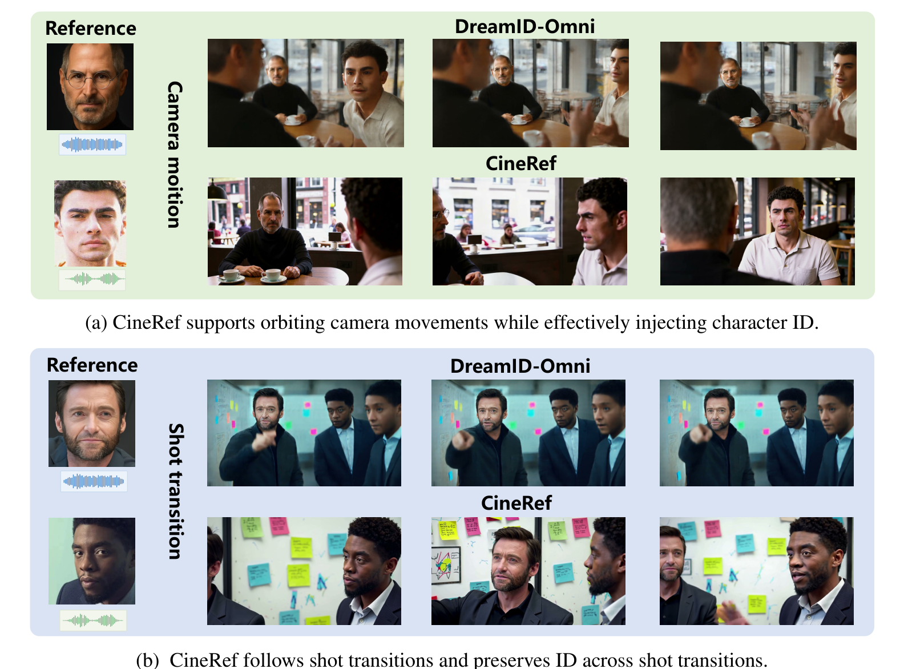
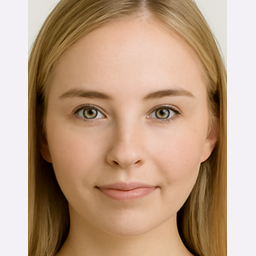
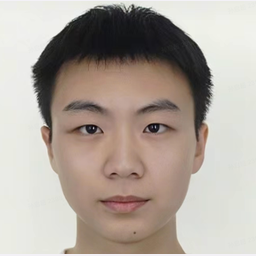

# CineRef: Cinematic Reference-Guided Audio-Video Generation

<p align="center">
  <a href="https://zqhang.github.io/cineref/">🌐 Project Page</a> |
  📜 Paper (coming soon) |
  <a href="https://github.com/zqhang/CineRef">💻 Code</a> |
  🤗 Models (coming soon)
</p>

> **CineRef: Cinematic Reference-Guided Audio-Video Generation**<br>
> Qihang Zhou, Chuming Lin, Bin-Bin Gao, Feifan Xu, Xu Chen, Junwei Zhu, Chengjie Wang
> <br>Tencent<br>

<p align="center">

</p>

## 📋 Todo List

- [x] Release the project page with qualitative comparisons
- [ ] Release the paper
- [ ] Release model weights

## 🔥 News

- [10/24/2026] 🔥 Project page and qualitative comparisons are released.

## 🎬 Demo

Each example pairs two reference people with their own reference voice (`<id>_ref0.wav` for reference 0, `<id>_ref1.wav` for reference 1), and the same pair conditions all three methods. Click a reference image to open the original file, or a voice file to open it in the browser's built-in audio player and listen on its own. GitHub does not allow inline audio players in README files.

### Example 40

| Reference 0 | Reference 1 |
|:--:|:--:|
| <a href="assets/references/40_ref0.png"></a><br>[40_ref0.wav](https://github.com/zqhang/CineRef/raw/main/assets/audio/40_ref0.wav) | <a href="assets/references/40_ref1.png"></a><br>[40_ref1.wav](https://github.com/zqhang/CineRef/raw/main/assets/audio/40_ref1.wav) |

| LTX-Ingredients | DreamID-Omni | **CineRef (ours)** |
|:--:|:--:|:--:|
<a href="assets/previews/40-ltx.webp"></a> | <a href="assets/previews/40-dreamid.webp"></a> | <a href="assets/previews/40-cineref.webp"></a> |
<a href="assets/videos/ltx-ingredients/40.mp4">Full video</a> | <a href="assets/videos/dreamid-omni/40.mp4">Full video</a> | <a href="assets/videos/40.mp4">Full video</a> |

## Overview

Reference-guided audio-video generation should preserve who appears and who speaks, even as the camera moves and the shot changes. CineRef links references to generated content during training and keeps them consistent across the whole clip, targeting identity drift, copy-and-paste artifacts, and unreliable audio-visual correspondence under large camera motion and frequent shot transitions.

## ⚡️ Playback

The [project page](https://zqhang.github.io/cineref/) plays the three methods of one example together from the same start time, with a single audible track at a time. Individual players support seeking, volume, and fullscreen.

## 🚀 Local Preview

```bash
python3 serve_preview.py . --port 8000
```

Or simply open `index.html` in a browser. No build step or external dependency is required.

## 📁 Repository Layout

```text
CineRef/
├── README.md
├── index.html
├── serve_preview.py
└── assets/
    ├── app.js, style.css, favicon.svg, gallery.json
    ├── references/     # 8 reference images + thumbs/ (square 256px)
    ├── videos/         # CineRef outputs; ltx-ingredients/ and dreamid-omni/ baselines
    ├── posters/        # 12 video thumbnails
    ├── previews/       # 12 short per-method previews
    ├── images/         # manuscript figures
    └── audio/          # reference voices (WAV)
```

## ⭐ Citation

Citation information will be added together with the paper release.
### Example 09

| Reference 0 | Reference 1 |
|:--:|:--:|
| <a href="assets/references/9_ref0.png"></a><br>[9_ref0.wav](https://github.com/zqhang/CineRef/raw/main/assets/audio/9_ref0.wav) | <a href="assets/references/9_ref1.png"></a><br>[9_ref1.wav](https://github.com/zqhang/CineRef/raw/main/assets/audio/9_ref1.wav) |

| LTX-Ingredients | DreamID-Omni | **CineRef (ours)** |
|:--:|:--:|:--:|
<a href="assets/previews/9-ltx.webp"></a> | <a href="assets/previews/9-dreamid.webp"></a> | <a href="assets/previews/9-cineref.webp"></a> |
<a href="assets/videos/ltx-ingredients/9.mp4">Full video</a> | <a href="assets/videos/dreamid-omni/9.mp4">Full video</a> | <a href="assets/videos/9.mp4">Full video</a> |

### Example 36

| Reference 0 | Reference 1 |
|:--:|:--:|
| <a href="assets/references/36_ref0.png"></a><br>[36_ref0.wav](https://github.com/zqhang/CineRef/raw/main/assets/audio/36_ref0.wav) | <a href="assets/references/36_ref1.png"></a><br>[36_ref1.wav](https://github.com/zqhang/CineRef/raw/main/assets/audio/36_ref1.wav) |

| LTX-Ingredients | DreamID-Omni | **CineRef (ours)** |
|:--:|:--:|:--:|
<a href="assets/previews/36-ltx.webp"></a> | <a href="assets/previews/36-dreamid.webp"></a> | <a href="assets/previews/36-cineref.webp"></a> |
<a href="assets/videos/ltx-ingredients/36.mp4">Full video</a> | <a href="assets/videos/dreamid-omni/36.mp4">Full video</a> | <a href="assets/videos/36.mp4">Full video</a> |

### Example 39

| Reference 0 | Reference 1 |
|:--:|:--:|
| <a href="assets/references/39_ref0.png"></a><br>[39_ref0.wav](https://github.com/zqhang/CineRef/raw/main/assets/audio/39_ref0.wav) | <a href="assets/references/39_ref1.png"></a><br>[39_ref1.wav](https://github.com/zqhang/CineRef/raw/main/assets/audio/39_ref1.wav) |

| LTX-Ingredients | DreamID-Omni | **CineRef (ours)** |
|:--:|:--:|:--:|
<a href="assets/previews/39-ltx.webp"></a> | <a href="assets/previews/39-dreamid.webp"></a> | <a href="assets/previews/39-cineref.webp"></a> |
<a href="assets/videos/ltx-ingredients/39.mp4">Full video</a> | <a href="assets/videos/dreamid-omni/39.mp4">Full video</a> | <a href="assets/videos/39.mp4">Full video</a> |


## Overview